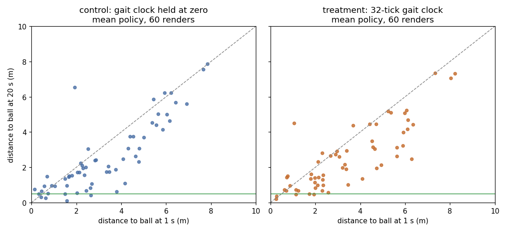

# Verdict: reject the gait clock; clock channels and `--gait-clock` removed

The keep rule needed both gates. The clock passed the reach gate but failed the closing gate, so it is rejected and removed from main.

| Training seed | Control reach, 30–40M | Clock reach, 30–40M | Control holds | Clock holds | Control inverted at 20 s | Clock inverted at 20 s |
|---|---:|---:|---:|---:|---:|---:|
| 351 | 0.1092 | 0.0835 | 0/20 | 1/20 | 16/20 | 4/20 |
| 352 | 0.0663 | 0.1019 | 1/20 | 0/20 | 11/20 | 14/20 |
| 353 | 0.0497 | 0.0593 | 3/20 | 2/20 | 9/20 | 9/20 |
| Pooled | 0.0755 | 0.0817 | 4/60 | 3/60 | 36/60 | 27/60 |

- **Reach gate, pass.** 40,534 control and 40,697 clock episodes fall in the 30–40M window. The one-sided z test of H1 control > clock gives z = −3.31, p = 0.9995, so there is no harm ([pooled-reach.txt](pooled-reach.txt)).
- **Closing gate, fail.** Pooled close-and-hold is 3/60 with the clock against 4/60 without. The one-sided Fisher exact test of H1 clock > control gives p = 0.78 ([pooled-hold.txt](pooled-hold.txt)).
- **Integrity.** All six runs ended at 40,000,512 ticks with unit exit 0, one cold start each and no rl#343 trip. Every other launch was a warm resume after the runner's CPU-turn pause, on the same binary: every launch line in every run records `rl-train` `de09495f…` ([provenance.txt](provenance.txt)).

Closing by spawn distance ([by-spawn.txt](by-spawn.txt)) is the same failure as the last A/B. From 2.5 m or farther, the clock arm got within 0.5 m in 0/34 cases and control in 1/33. The median closed from 4.5 m or farther was 1.45 m with the clock and 1.04 m without, the range of a random open-loop gait. Mean drive and effort are the same in both arms (0.850 / 29.8 with the clock, 0.859 / 30.3 without), so the policy is as active either way; a phase signal alone did not turn that activity into travel. Training seed 351's clock arm ended inverted far less often (4/20 against 16/20), but the other two seeds do not repeat it and inversion is not a gate.

Method: 120 mean-policy renders, one per checkpoint × eval seed 351–370, rendered from `ckpt/marks/40000000` by the pinned `rl-demo` ([render.sh](render.sh), [render-status.txt](render-status.txt)). Scoring used `../upright-shaping-ab/analyze.py` unchanged through [score.sh](score.sh); its fixed `k12` label is the clock arm. Pooled tests come from [stats.py](stats.py); 5M reach buckets are `buckets-*.txt` from `../upright-shaping-ab/reach5m.awk`. The pinned binaries' runtime libraries had been collected from the store by the time of the read; they were restored from the same toolchain pin, and the binaries ran unchanged: their SHA-256 at read time matches [README.md](README.md) ([provenance.txt](provenance.txt)). The 10 s frames of eval seed 351 were checked visually and show Sally in every run, the ball off-frame in two ([tiles](eval351-10s-tiles.png): control seeds 351–353 on top, clock below).
