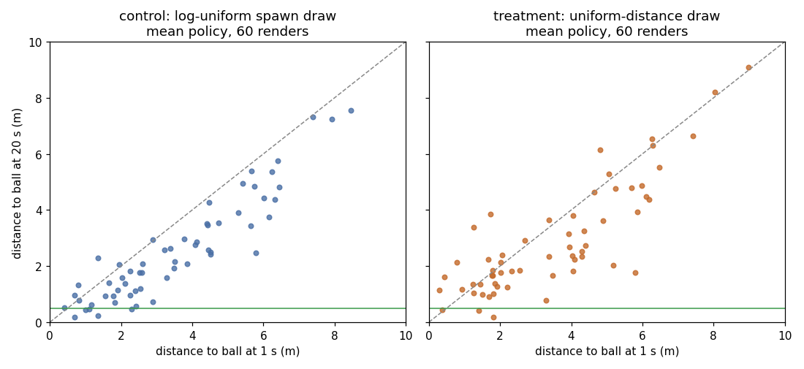

# Verdict: reject uniform-distance spawns; `--band-draw` removed

The keep rule needed both gates. Treatment passed the reach gate but failed the closing gate, so the change is rejected and the option is removed from main.

| Training seed | Control reach, 30–40M | Uniform reach, 30–40M | Control holds | Uniform holds | Control inverted | Uniform inverted |
|---|---:|---:|---:|---:|---:|---:|
| 351 | 0.0638 | 0.1068 | 3/20 | 0/20 | 11/20 | 8/20 |
| 352 | 0.0816 | 0.0547 | 0/20 | 0/20 | 16/20 | 9/20 |
| 353 | 0.0481 | 0.0624 | 0/20 | 3/20 | 3/20 | 14/20 |
| Pooled | 0.0646 | 0.0748 | 3/60 | 3/60 | 30/60 | 31/60 |

- **Reach gate, pass.** 40,392 control and 40,649 treatment episodes fall in the 30–40M window. The one-sided z test of H1 control > treatment gives z = −5.73, p = 1, so there is no significant harm ([pooled-reach.txt](pooled-reach.txt)). Treatment reaches more often even though more of its spawns are far.
- **Closing gate, fail.** Pooled close-and-hold is 3/60 against 3/60. The one-sided Fisher exact test of H1 treatment > control gives p = 0.66 ([pooled-hold.txt](pooled-hold.txt)).
- **Integrity.** All six runs ended at 40,000,512 ticks with unit exit 0 and no rl#343 trip. Every run warm-resumed from its checkpoint several times. Each run also has one startup panic, "No Discrete GPU device found": the host's GPU disappeared once, before any update, and the restart that followed resumed warm ([provenance.txt](provenance.txt)).

Closing by spawn distance ([by-spawn.txt](by-spawn.txt)) shows the same failure in both arms. Every approach to within 0.5 m started within 2.5 m of the ball. From 2.5 m or farther, neither arm got within 0.5 m in 20 s: 0/37 control and 0/34 treatment. The median closed from 4.5 m or farther was 1.38 m for control and 0.90 m for treatment. Putting more training spawns far out did not teach travel. The extra reach in training is still stochastic and is not chase.

Method: 120 mean-policy renders, one per checkpoint × eval seed 351–370, with each run's own `rl-demo` (built at `1ab752d`) and plant. Scoring used `../upright-shaping-ab/analyze.py` unchanged. Its fixed `k12` label is the uniform arm; [scorer-s351.txt](scorer-s351.txt) and its siblings relabel it. One render (uniform, training seed 353, eval seed 359) first hit the 400 s timeout. It was rerun, and its trace matched sample for sample ([render-status.txt](render-status.txt)). The 10 s frames of eval seed 351 were checked visually and show Sally and the ball.
