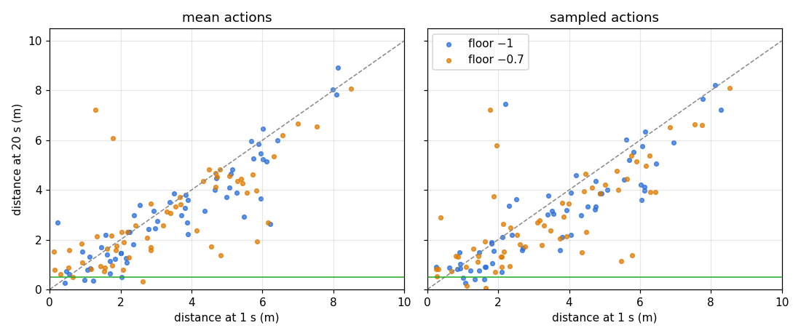

# Sampled-vs-mean sweep of the entropy-floor checkpoints

Verdict: **the policy has not learned to close.** Sampled actions hold the ball no
more often than the mean action: 4/120 each, discordant pairs 4–4, one-sided exact
McNemar p = 0.64. The deterministic mean is not what fails; the next change
targets learning.

This is the first bounded step of the flat mean-policy chasing baseline in
[#351](https://github.com/bddap/rl/issues/351). No training ran. The protocol was
registered on the issue before any scored render.

Points on the dashed diagonal did not move toward the ball; the green line is the
0.5 m hold distance.

## Inputs

- The six registered 40M checkpoints of the [entropy-floor A/B](../entropy-floor-ab/README.md):
  floor −1 (control) and −0.7 × training seeds 351–353, `ckpt/marks/40000000`,
  40,000,512 ticks.
- That A/B's evaluator (`rl-demo` SHA-256 `70746b5e…`, built from `24b3c49`) and
  plant (`sally.glb` `119d5a4f…`). Its existing `--exploration-log-std-floor` mode
  applies the trainer's seeded OU exploration, so nothing was rebuilt.

## Method

- Sampled: `render.sh <arm> <training seed> sampled <eval seed> <out>` for eval
  seeds 351–370, flat ≤ 9 m, 20 s, with each checkpoint's own 40M training floor
  (−1 or −0.7). One draw per eval seed, 120 renders; all exited 0
  ([render-status.txt](render-status.txt)), each trace has the 20 ordered samples
  and `RENDER_CHECKPOINT ticks=40000512`. Checkpoint paths in [traces/](traces/)
  are normalized to the run name.
- Mean: the A/B's 120 published traces. Two were re-rendered first (floor −1
  training seed 351 eval seed 351; floor −0.7 training seed 352 eval seed 360);
  both matched their published trace sample for sample.
- Scoring: `score.sh` runs `../upright-shaping-ab/analyze.py` unchanged per
  training seed and mode (`scorer-*.txt`; its `k12` label is the floor −0.7 arm,
  with no shaping), then `paired.py` and `by-spawn.py`.

## Reading

| Training seed | Floor | Mean holds | Sampled holds |
|---|---|---:|---:|
| 351 | −1 | 1/20 | 1/20 |
| 351 | −0.7 | 0/20 | 1/20 |
| 352 | −1 | 2/20 | 0/20 |
| 352 | −0.7 | 0/20 | 0/20 |
| 353 | −1 | 1/20 | 1/20 |
| 353 | −0.7 | 0/20 | 1/20 |
| pooled | | 4/120 | 4/120 |

Registered rule: a deterministic-policy gap needed sampled holds ≥ 2× mean holds and
McNemar p < 0.05. Neither holds.

Closing depends on where the ball starts ([by-spawn.txt](by-spawn.txt)):

| Mode | Distance at 1 s | n | Ever ≤ 0.5 m | Median closed in 20 s |
|---|---|---:|---:|---:|
| mean | < 2.5 m | 51 | 15 | 0.14 m |
| mean | 2.5–4.5 m | 28 | 1 | 0.35 m |
| mean | ≥ 4.5 m | 41 | 0 | 0.66 m |
| sampled | < 2.5 m | 49 | 17 | 0.03 m |
| sampled | 2.5–4.5 m | 31 | 0 | 0.73 m |
| sampled | ≥ 4.5 m | 40 | 0 | 1.06 m |

Every time either mode gets within 0.5 m but one, the ball started within 2.5 m.
From farther out she gains at most about 1 m in 20 s (≈ 0.05 m/s), sampled or
not. The 0.07–0.13 training reach is consistent with credit earned from short
spawns. What is missing is travel toward a ball more than a few metres away.

Inversion is unchanged by sampling: inverted at 20 s on 60/120 cases in both modes.
Sampling rights a few more bodies (13 against 4) without turning them into holds.
